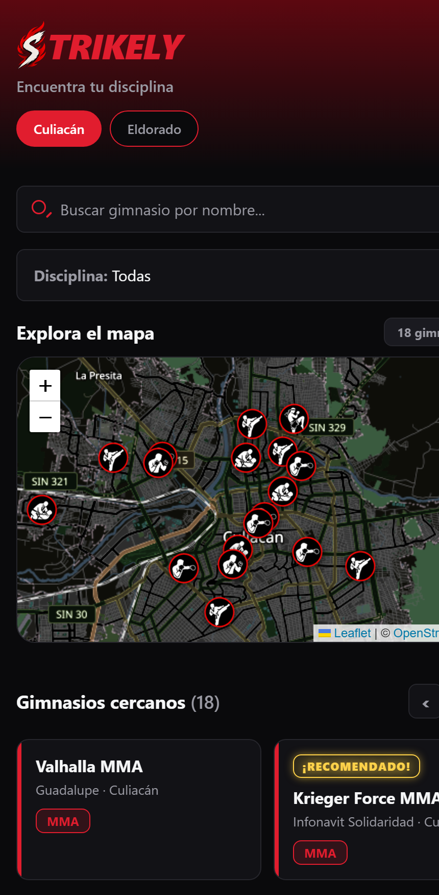
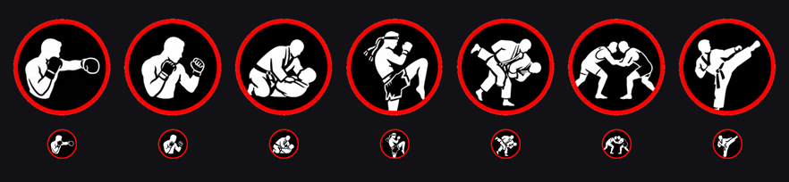

<p align="center">
  
</p>

<h1 align="center">Strikely</h1>

<p align="center">
  <b>Encuentra tu disciplina.</b><br/>
  Directorio de gimnasios de artes marciales en Culiacán, Sinaloa 🇲🇽
</p>

<p align="center">
  
  
  
  
  
</p>

---

## ¿Qué es?

Una app para **encontrar gimnasios de artes marciales en Culiacán** sin perder la tarde en Google Maps: aquí sí están los datos que importan — qué disciplinas dan, quién entrena, a qué hora y cómo contactarlos.

No es un clon de Google Maps. Es una **guía curada a mano**: **18 gimnasios** de Boxeo, MMA, Jiu-jitsu, Muay Thai y Taekwondo, con datos verificados uno por uno en sus propias redes.

**Aviso importante sobre los datos:** no se inventa nada. Lo que no se pudo verificar se queda vacío y, cuando el dato viene de un directorio público y no del gimnasio, la línea va marcada con `// ⚠️`. Los **precios no se publican a propósito**: eso se pregunta directo por WhatsApp con el botón de cada ficha.

---

## Lo que trae

- 🔎 **Buscador** por nombre de gimnasio.
- 🥋 **Filtro por disciplina** (7 + "Todas") con su color propio.
- 🏙️ **Filtro por ciudad** (Culiacán / Eldorado).
- 🗺️ **Mapa con marcador por disciplina**: cada chapita es el ícono de la disciplina (aro rojo, dibujo adentro); al seleccionarla **crece y brilla**.
- 🃏 **Fila de tarjetas**: se **arrastra con el mouse** en la compu (con flechas y efecto imán) y se **desliza con el dedo** en el celular.
- 📋 **Panel de detalle**: galería de fotos (se pasan con el dedo y se abren a pantalla completa con un visor), descripción, horario, entrenador, redes (WhatsApp, Instagram, Facebook, TikTok) y botón de **cómo llegar**.
- ⭐ **Insignia "¡RECOMENDADO!"** para los gimnasios de confianza.
- 📱 **Un layout que se adapta**: cajón lateral en pantallas anchas, hoja inferior en el celular, con animación de entrada.

## Capturas

<p align="center">
  
</p>

<p align="center">
  <i>Encabezado, buscador, filtro de disciplinas, el mapa con un marcador por disciplina y la fila de gimnasios cercanos.</i>
</p>

---

## Cómo correrlo

Necesitas [Node.js](https://nodejs.org) instalado.

```bash
# 1. dependencias
npm install

# 2. versión web (abre http://localhost:8081)
npx expo start --web
```

**En el celular** (Android o iPhone), con [Expo Go](https://expo.dev/go):

1. El proyecto usa **Expo SDK 58**, así que necesitas **Expo Go actualizado** (solo soporta la versión más nueva del SDK).
2. Que el celular esté en la **misma red Wi-Fi** que la compu.
3. En Expo Go: *Enter URL manually* → `exp://TU_IP_LOCAL:8081`

No hay API keys, ni cuentas, ni servidor: **todo corre local**.

---

## Stack

| Pieza | Qué se usó |
|---|---|
| Framework | **Expo SDK 58** (React Native 0.88 + React 19.3) |
| Web | `react-native-web` — el mismo código corre en el navegador |
| Mapa (web) | `leaflet` + `react-leaflet` |
| Mapa (celular) | `react-native-webview` con Leaflet dentro |
| Estilos | `StyleSheet` de React Native (**cero CSS**) |
| Animación | `Animated` de React Native |
| Datos | Archivos `.js` a mano — **sin base de datos** |

---

## Estructura

```
strikely/
├─ App.js                      # el "cerebro": filtros, selección y layout
├─ index.js                    # punto de entrada de Expo
│
├─ components/
│  ├─ Header.js                # logo, lema y cambio de ciudad
│  ├─ BarraBusqueda.js         # buscador por nombre
│  ├─ SelectorDisciplina.js    # píldoras de disciplinas
│  ├─ CabeceraMapa.js          # título y contador de resultados
│  ├─ MapaGimnasios.web.js     # mapa Leaflet (compu)
│  ├─ MapaGimnasios.native.js  # mapa en WebView (celular)
│  ├─ ListaGimnasios.web.js    # fila arrastrable + flechas (compu)
│  ├─ ListaGimnasios.native.js # fila deslizable con imán (celular)
│  ├─ TarjetaGimnasio.js       # la tarjeta de un gimnasio
│  ├─ PanelGimnasio.js         # panel de detalle (el archivo más grande)
│  ├─ IconoDisciplina.js       # dibuja el ícono que le toca
│  ├─ iconosDisciplinas.js     # disciplina → ícono
│  └─ iconosDatos.js           # GENERADO: íconos en base64 (no editar a mano)
│
├─ data/
│  ├─ gimnasios.js             # los 18 gimnasios (los datos de la app)
│  └─ disciplinas.js           # opciones del filtro
│
├─ theme/
│  └─ theme.js                 # colores y medidas: el diseño se manda desde aquí
│
├─ assets/
│  ├─ gimnasios/               # fotos de los gimnasios
│  ├─ iconos/                  # íconos de disciplina (160 px)
│  └─ iconos/mapa/             # versión chica para el mapa (48 px)
│
├─ docs/                       # capturas que usa este README
│
└─ herramientas/
   ├─ genera-iconos.ps1        # corta la hoja de íconos y rehace los PNG + base64
   └─ hoja-iconos.png          # hoja original con los 7 íconos
```

---

## Decisiones de diseño

**Un solo archivo manda el diseño.** `theme/theme.js` tiene los colores, los redondeos y el color de cada disciplina. Se usa 90 veces en el proyecto: si cambias un valor ahí, cambia toda la app.

**Tema oscuro por capas, no un negro y ya.** Hay tres niveles (`fondo`, `superficie`, `superficieClara`) y el **rojo solo aparece como acento**, nunca como relleno. Eso es lo que hace que se vea ordenado en lugar de ruidoso.

**Cero CSS.** Todo el estilo es `StyleSheet` de React Native, para que el mismo código se vea bien en web y en celular. Y como en React Native el flexbox va en **columna** por defecto, el `flexDirection: 'row'` aparece cada vez que algo va en horizontal.

**Un componente, dos comportamientos.** Las listas y los mapas existen en versión `.web.js` y `.native.js`: Metro (el empaquetador de Expo) elige solo el archivo según la plataforma, y así cada uno se siente nativo donde corre — el mouse arrastra en la compu, el dedo desliza en el celular.

**Los íconos viven en el código, no en carpetas.** Los dibujos se guardan como *data URI* (base64) en `iconosDatos.js` para que funcionen igual dentro de la app y dentro del HTML del mapa del celular. Ese archivo es **generado**: se rehace con `herramientas/genera-iconos.ps1`, que corta la hoja, le quita el fondo blanco y reescribe los PNG y el `.js`.

<p align="center">
  
</p>

---

## Estado del proyecto

Los 18 gimnasios ya están cargados con nombre, zona, dirección, coordenadas, descripción y redes. Falta lo que solo se consigue hablando con cada gimnasio:

| Dato | Cargados | Cómo se completa |
|---|---|---|
| Nombre, zona, dirección, descripción | **18 / 18** ✅ | — |
| Redes sociales | 11 WhatsApp · 11 Instagram · 11 Facebook · 1 TikTok | — |
| Horarios | **6 / 18** | Se los pide uno por uno |
| Entrenadores | **5 / 18** | Se los pide uno por uno |
| Fotos | **1 / 18** | Las da el gimnasio (las de Google Maps tienen derechos de autor) |

**Pendientes técnicos:**

- [ ] Confirmar los **11 datos marcados con `⚠️`** (vienen de directorios públicos, no del gimnasio).
- [ ] Gimnasios de **Judo** y **Lucha**: hoy las disciplinas existen en el filtro pero no tienen resultados.
- [ ] **Color propio para Taekwondo**: falta en el mapa de colores, así que sus 5 gimnasios caen en el color por defecto.
- [ ] **Ícono de app propio**: `assets/icon.png` sigue siendo el genérico de Expo.
- [ ] Capturas del panel de detalle y de la versión del celular.

**Y cuando el proyecto crezca:**

- [ ] **Base de datos (Supabase)** — solo cuando valga la pena: si los gimnasios van a editar su propia ficha, o si la app sale de Culiacán.
- [ ] Publicar en las tiendas (App Store / Play Store).

---

## Hecho en

Culiacán, Sinaloa. 🇲🇽

¿Eres dueño de un gimnasio y quieres aparecer, corregir tu ficha o poner tus horarios? Escríbenos.

> **Nota legal:** los nombres y datos de los gimnasios pertenecen a cada gimnasio. Las fotos se publican con autorización. Si algo tuyo aparece aquí y quieres que se cambie o se baje, pídelo y se hace.

---

## Licencia

MIT. El proyecto nació de la plantilla de [Expo](https://expo.dev) (el archivo `LICENSE` todavía lleva el aviso de Expo, y hay que actualizarlo).
